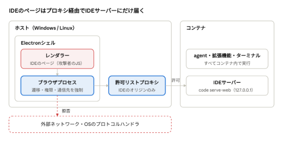

# VS Codeを隔離するElectronシェル（Windows/Linux共通）

> この文書は当初の設計記録。[進め方](#進め方)の1〜5は実施済みで、その後に次の変更を加えた。現在の構成と制約は[隔離エディタの手順](../../../.devcontainer/claude/code-server/README.md)を参照。
>
> - Linuxでもbubblewrapを使わず、シェルをホストで直接起動する。WindowsもLinuxも、Electron全体を囲むOS層の壁はなく、[OS別の隔離層](#os別の隔離層)のLinuxの列と進め方の3は現状と異なる。WaylandのほかX11でも起動できる。
> - todeのサポートは削除した。
> - 検証項目の結果は[残るリスクと検証項目](#残るリスクと検証項目)に記入した。

## 背景と目的

IDEのクライアントを、許可したオリジンにしか接続できない専用のElectronシェルにする。WindowsでもLinuxでも、コンテナ内のコードにホストでコマンドを実行させず、proxyを経由しない通信もさせずに、GUIのエディタをホストのIMEで使えるようにする。

claude-devcontainerは、Linuxのホストを前提に、agentの通信をproxyだけに通している。しかし[VS Codeで開く](../../usage.md#vs-codeで開く)で整理したとおり、Dev Containers拡張で接続すると、ホストでのコマンド実行やproxyを迂回する通信の経路ができ、その一部は設定では遮断できない。

その代わりとして、現在は次の2つがある。

- ターミナルで動かすtode
- `code-server.sh`で開く[隔離エディタ](../../../.devcontainer/claude/code-server/README.md)。OSごとに別の実装になっている。
  - Windows：専用AppContainerのWebView2で、agent内のcode-serverを表示する。外側の壁としてWFPのルールとループバック免除を入れるため、初回の`prepare`でUACによる管理者権限の承認が要る。
  - Linux：bubblewrapに入れたホストのVS Codeを、agent内の公式VS Code serverに接続する。resolver拡張がVS Codeのproposed APIに依存し、ホストのVS Codeと同じcommitのserverを用意する必要がある。

この提案では、隔離エディタの2つのクライアントを、両OSで共通のElectronシェル1つに置き換える。目的は次の2つである。

- 管理者権限なしでの利用：Windowsでも、管理者権限を使わずにVS Codeの経路を遮断する。
- 実装の一本化：WindowsとLinuxで、同じシェル、同じproxy、同じ設定を使う。

その代わりに、WindowsではAppContainerとWFPによるOS層の壁がなくなる（[OS別の隔離層](#os別の隔離層)）。

## 脅威モデル

コンテナ内で動くコードは、すべて攻撃者のものとみなす。agentに限らず、人間が走らせるテストや、拡張機能が実行するworkspaceのコード（ESLintの設定、ビルドスクリプトなど）も含む。

### 守るもの

- ホストでの任意のコマンド実行
- ホストの認証情報（Gitのcredential、SSH鍵、GitHubのトークン、Dockerの認証情報）
- proxyの許可リストを迂回した外部への通信（流出と、外部からの指令の受信）
- Docker APIへのアクセス（実質的にホストのroot権限に等しい）

### 許容するもの

- コンテナの中身（コード、作業ツリー、proxyを通る通信）を、攻撃者が読み、書き換えること
- IDEのUIに、攻撃者の用意した表示が出ること
- Chromiumのレンダラーからの脱出と、ブラウザプロセスの奪取を連鎖させる攻撃。これを想定する場合は、Windows SandboxやVMを使う。

ブラウザ版IDEでは、ページそのものをコンテナが配信する。そのため、IDEの画面で動くJavaScriptは攻撃者のコードであり、これをホストの通常のブラウザで動かせば、トップレベルナビゲーション、WebSocket、WebRTC、外部プロトコルの起動で外部と通信できる。この案は、これらの経路の遮断を主眼にしている。

## 検討した選択肢

管理者権限が不要で、Windows Homeでも動き、両OSで同じコードを使えるのはElectronシェル案だけである。

| 案 | 管理者権限 | Windows Home | 主な問題 | 判定 |
| --- | --- | --- | --- | --- |
| 現行のWindowsクライアント（WebView2＋AppContainer＋WFP） | 初回の`prepare`で必要（WFPのルールとループバック免除） | 可 | Windows専用で、Linuxとは別の実装になる | 置き換える |
| 現行のLinuxクライアント（bubblewrap内のホストのVS Code） | 不要 | 対象外 | Linux専用。resolver拡張がproposed APIに依存し、ホストのVS Codeのcommitごとにserverを取得する | 置き換える |
| VS Code本体をAppContainerで隔離 | 不要（ループバック免除やDockerパイプのACLを使うと要る） | 可 | AppContainerは名前付きパイプを`\\.\pipe\LOCAL\`配下にしか作れない。libuv、VS CodeのIPC、node-ptyにパッチが要り、毎月の追従が必要 | 保守コストが大きい |
| Windows SandboxでVS Codeを動かす | 有効化の初回のみ必要 | 不可 | 同時に1インスタンスまで。Linuxでは使えない | Windows Pro向けの代替 |
| 通常のブラウザでブラウザ版IDE（＋CSPの強制） | 不要 | 可 | CSPではトップレベルナビゲーションとWebRTCを遮断できない | 不十分 |
| Tauriのシェル | 不要 | 可 | LinuxではWebKitGTKになり、ポリシーを二重に実装することになる | 実装を一本化できない |
| Electronシェル（本提案） | 不要 | 可 | Electronの更新への追従。WindowsではOS層がなくなる。Linuxではレンダラーのサンドボックスに前提条件がある | 採用 |

Dev Containers拡張をサンドボックス内で使う案は、どの方式でも採らない。サンドボックスにDocker APIを渡すことになり、`docker run --privileged`でホストの権限を得られるからである。

## 提案構成

agent内でIDEのサーバー（Coder code-server）を動かし、ホストではそれを表示するだけの専用Electronシェルを使う。シェルは、IDEのオリジン以外へのあらゆる通信と遷移を、レンダラーの外側（ブラウザプロセスとネットワークサービス）で拒否する。

IDEのサーバーにはCoderのcode-server 4.132.0を使う。以前の`code serve-web`では、webviewの配信先とWorkspace Trustの指定をパッチで変更していた。その保守を減らすため、同一オリジンでwebviewを配信し、`--disable-workspace-trust`を備えるcode-serverへ移行する。配布物はバージョンとSHA-256を固定し、todeと共有する。

拡張はcode-server標準のOpen VSXからビルド時に入れる。`EXTENSIONS_GALLERY`によるMicrosoft Marketplaceへの上書きは行わない。Microsoft公式ビルドからCoderのビルドへ信頼対象が変わり、内蔵VS Codeもserve-webの1.142からcode-server同梱版（commit `313bf03…`）へ下がる。code-serverの更新は別に判断する。

レンダラーからの通信は、シェルのブラウザプロセスと許可リストプロキシを通って、IDEサーバーにだけ到達する。それ以外の行き先はすべて拒否される。図ではプロキシをホストの枠に描いているが、実体はagentとは別のコンテナ（既存の`code-server-proxy`）で、ホストの127.0.0.1に公開する。

### オリジンの割り当て

IDE、webview、agent内のWebアプリは、すべて`http://localhost`に置き、ポートで区別する。シェルの通信はすべてプロキシを通るので、これらのポートはホストで待ち受けるものではなく、プロキシが転送先を決めるための名前である。

| オリジン | 内容 | プロキシの転送先 |
| --- | --- | --- |
| `http://localhost:18000` | IDEとwebview | agentのcode-server |
| `http://localhost:<port>` | agent内のWebアプリ | agentの同じポート |

SameSiteはポートを区別しないので、この割り当てでは、IDE、webview、アプリが同じサイトになる。VS CodeのSimple Browserは、アプリをwebviewのiframeのさらに内側のiframeで表示する。Chromiumは、上位のフレームがすべて最上位のページと同じサイトのときだけ、iframeで`SameSite=Lax`のCookieを送る。localhostのサブドメインはそれぞれ別のサイトとして扱われるので、code-serverのように`ide.localhost`と`port-<port>.localhost`に分けると、ForgejoなどのログインのCookieが送られない。ヘッドレスChromeで、iframeで`SameSite=Lax`のCookieが送られるかを3つの割り当てで比べたところ、この割り当てでは送られた。code-serverと同じ割り当てと、webviewだけを別のホストに置いた割り当てでは、送られなかった。

アプリのURLは、agentの中と同じ`http://localhost:<port>/`になる。たとえばForgejoの`ROOT_URL`は`http://localhost:3000/`のままでよい。18000番は、アプリには使えない。

アプリは、IDEやwebviewとオリジンが異なる（ポートが異なる）ので、`X-Frame-Options: SAMEORIGIN`を返すアプリはiframeで表示されない。Forgejoも既定の設定でこのヘッダーを返す。そのため、プロキシは、agent内のWebアプリの応答から`X-Frame-Options`とCSPの`frame-ancestors`を取り除く。アプリはagentの中で動く、攻撃者が制御できるものなので、埋め込みの制限を外しても守るものは減らない。IDEとwebviewの応答は変更しない。

この割り当てには、次の制約がある。どちらも、脅威モデルの守るものには影響しない。

- VS Codeの既定ではwebviewごとにホスト名が異なり、オリジンも分かれるが、この割り当てではすべてのwebviewが同じオリジンになる。webviewの中身は、どれもagentの拡張機能かworkspaceの内容から作られる。
- Cookieはポートを区別しないので、IDEの接続トークンのCookieも、agent内のWebアプリに送られる。agentはもともとIDEのサーバーを動かしているので、トークンを得ても新たにできることはない。

### 部品

- IDEサーバー（agent内）：code-server。agentの127.0.0.1で待ち受け、ホストのポートには公開しない。`code-server-proxy`からの接続は、agentのfirewallがループバックへ転送する（[進め方](#進め方)の2）。接続トークンをかける。拡張機能もターミナルも、すべてここで動く。
- Electronシェル（ホスト、信頼する側）：1つのウィンドウにIDEだけを表示する。専用のsession partitionを使い、認証情報は何も持たない。`nodeIntegration: false`、`contextIsolation: true`、`sandbox: true`、`webviewTag: false`、`devTools: false`、`spellcheck: false`とし、preloadスクリプトは使わない。Electronは、バージョンとSHA-256を固定して取得する。シェルのコードは、agentが書き換えられない場所に置く。
- 許可リストプロキシ：既存の`code-server-proxy`を使う。agentとは別のコンテナで、許可リスト（`proxy.py`）をagentからは書き換えられない。[オリジンの割り当て](#オリジンの割り当て)の`localhost`のオリジン以外は拒否する。agent内のWebアプリの応答からは、`X-Frame-Options`とCSPの`frame-ancestors`を取り除く。

### 強制ポイント

| 遮断する経路 | 手段 |
| --- | --- |
| トップレベルとiframeのナビゲーション | `will-frame-navigate`（メインフレームを含む）で、許可したオリジン以外を拒否する |
| サーバーからのリダイレクト | ナビゲーションのイベントは発火しないので、`will-redirect`で拒否する。HTTPのリダイレクト先は、プロキシと`webRequest`でも検査する |
| 新規ウィンドウ | `setWindowOpenHandler`で常に拒否する。agent内のWebアプリ（`localhost:<port>`）は、VS CodeのSimple Browserで開く |
| HTTPとWebSocket | `session.setProxy`の`fixed_servers`でプロキシに固定し、`proxyBypassRules`に`<-loopback>`を指定する。Chromiumは既定で`localhost`、`*.localhost`、127.0.0.1宛ての通信をプロキシに通さないので、指定しないと、ホストのループバックの任意のポートに直接接続できる。`webRequest.onBeforeRequest`でもオリジンを検査する |
| WebRTCのUDP | `setWebRTCIPHandlingPolicy('disable_non_proxied_udp')`を指定する |
| 外部プロトコル（`vscode://`、`ms-settings:`など） | `setPermissionRequestHandler`で`openExternal`の要求を拒否する。Electronでは、外部プロトコルの起動は、ナビゲーションとリダイレクトのどちらから来てもこの権限の要求を経由する。ナビゲーションの段階でも拒否し、`shell.openExternal`は呼ばない |
| ダウンロード | `will-download`で拒否する |
| 権限の要求（クリップボードの読み取り、通知など） | `setPermissionRequestHandler`と`setPermissionCheckHandler`で、既定では拒否する |
| デバイスAPI（WebHID、WebUSB、Web Serial、Web Bluetooth） | `setPermissionRequestHandler`を経由しないので、`setDevicePermissionHandler`で拒否し、`select-hid-device`などの選択イベントでは常に取り消す |
| 画面の取得 | `setDisplayMediaRequestHandler`で拒否する |
| webviewのリソース | 既定の`*.vscode-cdn.net`を使わず、webviewのエンドポイントを`localhost:18000`で自前で配信する |

プロキシとナビゲーションの判定は、レンダラーの外側で行う。そのため、レンダラーが攻撃者の制御下に入っても、レンダラーからはこれらの判定を変更できない。

## OS別の隔離層

シェルとプロキシのコードは両OSで共通にする。ただし、その外側の壁はLinuxでは2段、Windowsでは1段になり、保証の強さが異なる。この非対称性はドキュメントに明記する。

| | Linux | Windows |
| --- | --- | --- |
| アプリケーション層 | Electronシェル＋許可リストプロキシ | 同左 |
| OS層 | bubblewrapで`--unshare-net`。中はループバックのみで、bind mountしたUNIXソケットと中継で、プロキシにだけ接続する。現行のLinuxクライアント（`linux/client.py`）の仕組みをそのまま使う | なし。現行のAppContainerとWFPは、ループバック免除とWFPのルールに管理者権限が要るので使わない |
| レンダラーのサンドボックス | Ubuntu 23.10以降は、AppArmorが非特権user namespaceを制限する。bubblewrap自体も同じ制限を受ける。AppArmorプロファイルか、setuidの`chrome-sandbox`が必要 | 追加の準備は不要 |
| 管理者権限 | 不要（AppArmorプロファイルを入れる場合は必要） | 不要 |

Chromiumのサンドボックスは、レンダラーなどの子プロセスから、ファイルやプロセスの起動といったOSの資源へのアクセスを制限する仕組みである。Windowsでは、一部の子プロセスをAppContainerで動かす機能も持つ。しかし、ブラウザプロセスはユーザーの権限で動き、ネットワークサービスの接続先も、プロキシなどのChromiumの設定だけで決まる。そのため、Windowsで接続先を制限するのは、シェルのポリシーの実装だけになる。現行のWindowsクライアントは、ブラウザプロセスを含むすべてのプロセスを専用のAppContainerに入れ、WFPで接続先をプロキシだけに制限していたが、この構成にはその壁がない。

`--no-sandbox`での回避は禁止する。レンダラーが攻撃者の制御下に入っても、強制はレンダラーの外側で行われる、というこの案の前提が成り立たなくなるからである。Windows Proで、より強い保証が必要な利用者向けには、Windows Sandboxでシェルを動かす構成を、任意の追加層として残す。

Windowsでは、ホスト側スクリプト群（認証情報の注入、gitのext転送、イメージの読み込み）とDocker（`code-server-proxy`を含む）をWSL2で動かし、シェルだけをWindows側に置く。シェルは、WSL2がWindowsの127.0.0.1に転送するプロキシのポートに接続する。これは現行のWindowsクライアントと同じ接続方法である。

## 残るリスクと検証項目

最大の残余リスクは、Windowsではシェルのポリシーの実装だけが壁になることである。以下は実装の前後に実機で確かめる。

結果は2026-10-17時点の[テストと動作確認の結果](../../testing.md)による。Linuxの結果の多くは、headlessのElectronで`tests/electron_shell_test.py`と`tests/code_server_browser_test.py`を動かして得た。Windowsでは、シェルの起動とIDEへの接続だけを確認している。

- [x] 外部プロトコルのURL（`vscode://`、`ms-settings:`など）への遷移が、リンク、`location`の変更、iframe、サーバーからのリダイレクトのどれでも、OSのハンドラを一切起動せずに拒否されること
  - Linuxで確認した（[シェルの判定](../../testing.md#シェルの判定)）。Windowsは未確認。
- [x] `localhost`、`*.localhost`、127.0.0.1の任意のポートへのfetchとWebSocketが、プロキシを通って拒否されること
  - Linuxで確認した。ホストのループバックへの接続は0件。
- [x] Service WorkerとWeb Workerからのfetch、WebSocketが、すべてプロキシを通ること
  - Linuxで確認した。
- [x] `disable_non_proxied_udp`の指定下で、WebRTCがホストの外へ出ないこと
  - Linuxで確認した。STUNサーバーを指定してもICE候補は0件。Windowsは未確認。
- [x] DNSプリフェッチや`<link rel=prefetch>`がプロキシを迂回しないこと
  - Linuxで確認した。
- [ ] WebHID、WebUSB、Web Serial、Web Bluetoothの要求が、選択画面を出さずに拒否されること
  - 実装済み。選択画面は利用者の操作が要るので、実機では確かめていない。
- [x] webviewのエンドポイントを自前で配信した状態で、拡張機能のwebviewが表示されること
  - code-serverへの移行後は、webviewをIDEと同じ`localhost:18000`から配信する。`tests/code_server_browser_test.py`で確認した（[code-serverへの移行の検証](../../testing.md#code-serverへの移行の検証2026-10-15)）。
- [x] ForgejoをSimple Browserで開き、ログインできること（`X-Frame-Options`の除去と、`SameSite=Lax`のCookie）
  - 利用者の環境で確認した（[Forgejoでのレビュー](../../testing.md#forgejoでのレビュー2026-10-15)）。
- [x] クリップボードの貼り付けが、読み取り権限を許可しなくても、実用上困らない範囲で動くこと
  - Ctrl-V、Ctrl-Shift-V、Shift-Insertは、シェルがElectronのpasteでフォーカス中のフレームへ渡す。読み取り権限は拒否したままなので、右クリックメニューからは貼り付けられない。
- [ ] 日本語IME（WindowsのIME、Waylandのtext-input-v3）で、候補位置、インライン変換、再変換が動くこと
  - Waylandでは、エディタ、Ctrl+Pの入力欄、統合ターミナルで入力できた（[Linuxで隔離エディタを開く](../../testing.md#linuxで隔離エディタを開く)）。候補位置と再変換は個別には確かめていない。WindowsとX11は未確認。
- [ ] ~~Linuxで、bubblewrapの中のElectronが、レンダラーのサンドボックスを有効にしたまま起動すること（namespaceの入れ子）~~
  - bubblewrapをやめたので対象外。bubblewrapなしでは、レンダラーのサンドボックスを有効にしたまま起動することを確認した。AppArmorが非特権user namespaceを制限するUbuntu 23.10以降では未確認で、`prepare`がこの制限を検出して警告する。
- [ ] usage.mdの経路表にある各経路が、この構成で実際に遮断されていること
  - 経路表はDev Containers拡張が作る経路で、この構成はDev Containers拡張を使わない。経路ごとの実機確認はしていない。

このほか、Electronのセキュリティ更新に追従し続けることが、運用上の継続的なコストになる。

## 進め方

Linuxで共通部分（シェルとプロキシ）を完成させ、既存のbubblewrapを流用してLinuxのOS層を足してから、Windowsに対応する。最後に、現行の2つのクライアントを削除する。

1. PoC（Linux）：Electronシェルとagent内のcode-serverを、既存の`code-server-proxy`経由で接続し、強制ポイントを実装する。検証項目のうち、OSに依存しないものを確認する。
2. webviewとagent内のWebアプリ：[オリジンの割り当て](#オリジンの割り当て)のとおりに、webviewのエンドポイントを自前で配信し、プロキシがポートで転送先を決めるようにする。code-serverが生成する`/proxy/<port>/...`は、信頼するproxyが`http://localhost:<port>/...`へ302で戻す。パスとクエリを保持し、code-serverのパス中継には渡さない。`VSCODE_PROXY_URI`と`--proxy-domain`は指定しない。agent内に中継のプロセスは置かず、agentのfirewallが`code-server-proxy`からの接続をすべてagentの127.0.0.1へDNATする。これには`net.ipv4.conf.all.route_localnet=1`が要る。127.0.0.1と0.0.0.0のどちらで待ち受けるアプリにも接続でき、ほかの送信元からの接続は、INPUTの既定のDROPで拒否される。route_localnetを有効にすると、ループバック宛てのパケットをほかのインターフェースからも受け取るので、INPUTの既定はDROPのまま保つ。この組み合わせは、network namespaceとveth、iptables（nf_tables）で動作を確かめた。ForgejoをSimple Browserで開き、ログインできることを確かめる。
3. LinuxのOS層：`linux/client.py`のbubblewrap（`--unshare-net`とUNIXソケットの中継）の中で、VS Codeの代わりにElectronシェルを起動する。Waylandの入力メソッドの指定（text-input-v3）も引き継ぐ。AppArmorの前提条件を整える。
4. Windows対応：WSL2でホスト側スクリプトとDockerを動かし、シェルをWindowsで動かす。Windows固有の検証項目（外部プロトコル、WebRTC、IME）を確認する。
5. 置き換え：現行のWindowsクライアント（`windows/`のWebView2、AppContainer、WFP）、Linuxクライアントのresolver拡張とVS Code server（8089番）、code-server（8088番）を削除し、不要になる`codeServer.vscode`の設定も削除する。移行用に残していた旧WebView2環境のネットワーク設定削除コマンドは、試作・旧環境対応の整理に伴い削除済み。`[codeServer]`の設定から有効にできるようにし、`code-server/README.md`と[VS Codeで開く](../../usage.md#vs-codeで開く)を書き換えて、この構成で遮断される経路と残る経路を記載する。
